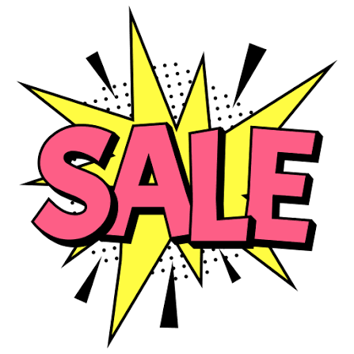
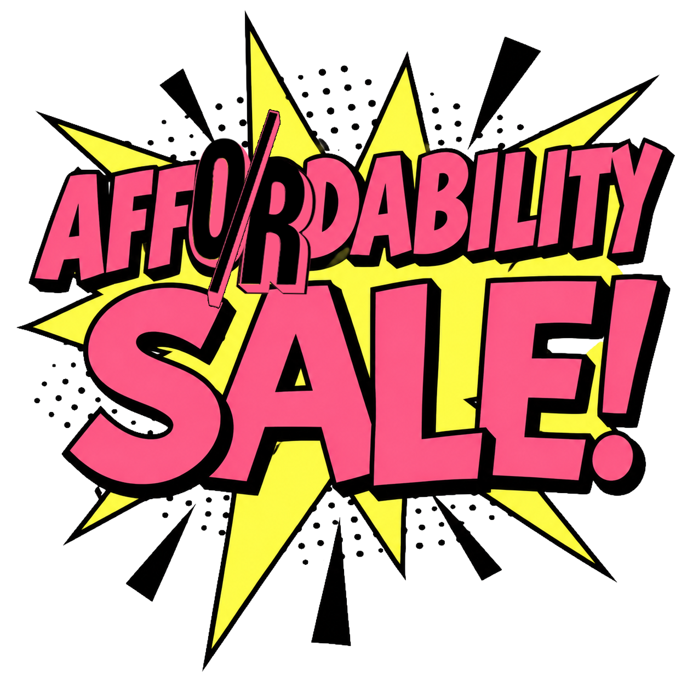

# Holiday sale — OR Books AFFO/RDABILITY (site embellishments)

## Client email (source of truth — original ask)

**From:** Antara Ghosh  
**To:** Rus  
**When:** 2026-11-12, ~1:44 PM  
**Subject:** (as received — holiday sale embellishments)

> Hi Russ,
>
> This is something we'd like to know if you'd be able to do for our Holiday Sale, which we will run from Monday till December 20. This will, of course, be separate from the rest of the website work (I'll get back to you on the Wave 2 stuff tomorrow). Basically, we want to add some embellishments to the website temporarily. Here is what we are thinking:
>
> 1. A 'Sticker' like this would appear on all pages. This is just a placeholder to give you the idea. I'll be sending you the designed sticker. Would be great if it could be blinking/flashing in some way to draw the eye. Maybe next to the OR logo?
> 2. I've attached a video of a ticker. We'd like to have something like this going at the top of all pages. Again, this is just a reference to show you what we are thinking.
>
> The idea (Colin's!) is to make it intentionally tacky, garish, and very in-your-face in terms of the discounts. We are calling it the OR Books AFFO/RDABILITY Sale.
>
> If this is something you'd be interested in doing for us, please let me know. I'll send more details and mockups to help you get a better idea, and you can give us an estimate based on that. What do you think?
>
> Best,  
> Antara

Full thread (including Nov 13 replies) is in **Email thread** at the bottom.

---

## Meta

| Field                    | Value                                                                                                                                                                                                  |
| ------------------------ | ------------------------------------------------------------------------------------------------------------------------------------------------------------------------------------------------------ |
| **Briefboard id**        | Phase **Holiday Banner** (sprint/phase 6) — https://lancemonotone.com/or-books/app/estimates?section=holiday-banner (or Estimates → Holiday Banner). Cards 6.1–6.4 = **5h / $625**                     |
| **Client contact**       | Antara Ghosh                                                                                                                                                                                           |
| **Sale window (client)** | Through **December 20** (extension possible; keep take-down easy to push out)                                                                                                                          |
| **Working title**        | OR Books **AFFO/RDABILITY** Sale                                                                                                                                                                       |
| **Tone**                 | Intentionally tacky, garish, in-your-face (Colin)                                                                                                                                                      |
| **Status**               | Client approved go-live; sale live on their side. **Launch checklist → [TASKS.md](./TASKS.md)** (one push, no stages).                                                                                 |
| **Branch**               | `feature/holiday-banner` (theme work in `orbooks-theme/`; live port = `orbooks-theme-prod-download/`)                                                                                                  |
| **Theme tree**           | **Live path:** sync/port holiday chrome into `orbooks-theme-prod-download/` → `stencil push` prod. Staging store (`orbooks.mybigcommerce.com`) was for preview only — **not** moving Wave WIP to live. |
| **Deploy**               | **Prod direct** (Antara Nov 13 + Nov 15). Staging down (423 maintenance; likely Enterprise→Scale). Temporary / toggleable.                                                                             |
| **Launch**               | **Monday ET** (client). Sale through Dec 20.                                                                                                                                                           |

**Build & todos:** see [TASKS.md](./TASKS.md) (this file = client communication only).

## Client ask (current)

**Core (estimate):**

1. **Sticker** — site chrome (mockup: by logo under ticker). Slow continuous pulse. Working art: `Affordability Sale Pop-Art Burst.png`; (almost) final: `Sticker.png` (**transparent bg**; may still tweak after Colin). Phone size: figure out in build.
2. **Top ticker** — sticky preferred (skip if too costly). Pixel / old video-game style font (**we pick the face**). Colors from her Amara ticker ref. Full copy locked (below). Not on cart/checkout/account. **Visual only — no links.**

**Layout (from Nov 13 mockup):** Header (logo + sticker) first; **ticker between header and content**; carousel stays theirs for sale promo graphics. (Email said “above the usual stuff”; mockup wins for ticker placement.)

**Optional / last priority (call in estimate or skip):**

3. **In Focus sale badge / dangling label** — Antara: “hanging/oscillating near the In Focus section,” marked on `sale homepage.jpg` (mockup shows a red “ROCK BOTTOM PRICE” burst on the first In Focus cover). For deeper-discount titles during the sale. Last priority; skip if too much. **Also visual only — no links.**

**Idea only (do not estimate now):**

4. Enable thin banners between New Releases / Bestsellers / In Focus with tacky graphics (theme option already exists, currently disabled).

## Rus decisions (Nov 13)

| Topic                 | Call                                                                                                                                                                                                                                 |
| --------------------- | ------------------------------------------------------------------------------------------------------------------------------------------------------------------------------------------------------------------------------------ |
| Links / click targets | **None.** Sticker, ticker, In Focus badge = visual only.                                                                                                                                                                             |
| Pixel font            | **We choose** closest webfont to her `image.png` vibe.                                                                                                                                                                               |
| Phone sticker size    | Decide in build.                                                                                                                                                                                                                     |
| Theme                 | **Was** staging-first preview. **Now (approved):** live only — port to `orbooks-theme-prod-download/` → prod. Staging store unavailable; Antara OK’d live-only Nov 13; asked again for live Nov 15 AM. Dual-deploy buffer **eaten**. |

## Decisions from Antara (Q1–7)

| #   | Topic               | Answer                                                                                                                                                                                                                            |
| --- | ------------------- | --------------------------------------------------------------------------------------------------------------------------------------------------------------------------------------------------------------------------------- |
| 1   | Sticker             | Working: `Affordability Sale Pop-Art Burst.png`. Almost final: `Sticker.png` (OR slash, **transparent PNG**). May change after Colin. Phone size: we’ll decide in build.                                                          |
| 2   | Ticker video + copy | Built on [Amara News Ticker Generator](https://amarasoftware.com/news-ticker-generator/) (notes in [TASKS.md](./TASKS.md)). Assets: `ticker-mwejkcuk.gif` + still. Colors red/yellow. Font vibe: `image.png`. **Wording locked.** |
| 3   | Animation           | Constant, not extremely fast; slow continuous pulse. Open to Rus suggestions.                                                                                                                                                     |
| 4   | Above vs replace    | **Above** usual stuff (mockup).                                                                                                                                                                                                   |
| 5   | Sticky              | Prefers sticky; OK to skip if complex/time-consuming.                                                                                                                                                                             |
| 6   | Take-down           | Manual **or** auto: whichever is least work for Rus. Extension should be easy.                                                                                                                                                    |
| 7   | Page exclusions     | Ticker not needed on cart/checkout/account; all other pages. Leaves judgement to Rus.                                                                                                                                             |

### Locked ticker copy

```
THE OR BOOKS AFFO/RDABILITY SALE: All paperbacks at $14.99 | All E-books $4.99 | Not applicable on hardcovers / pre-orders / pre-discounted book bundles | Free shipping above $100 | Weekly gifts for lucky customers | Offer valid till December 20 | Hurry!!
```

## Reply status

- Rus Nov 12 reply **sent**.
- Antara Nov 13 ~2:40 AM + ~10:51 AM: answers + assets (see thread below).
- BB wave **Holiday Banner** created Nov 13 (phase 6; after Wave 2 Deferred). Cards 6.1–6.4 = 5h / $625.
- Estimate email **sent**; Antara checking Colin → **approved Nov 13 ~10:34 PM** (“Please proceed”).
- Live-only confirmed Nov 13 (Rus 1:49 PM / Antara 10:34 PM). Staging later 423; Antara Nov 15 ~3:26 AM asks again for **live Sale features** (Monday ET launch).
- Support PIN (Antara): first recall `28991`; later `42766740`. Staging issue likely **Enterprise → Scale** plan change (Antara).
- **No Briefboard delivery comments yet** — post when shipping live.
- **Rus → Antara (Nov 15 ~9:17 AM):** local prod preview + video (`OR Books Holiday Recording 2026-11-15 091751.mp4`); noted mobile header badge hidden (no good slot); asked if she wants it elsewhere.
- **Antara → Rus (Nov 15 ~2:42 AM / thread timing):** loves it — **go live**. Mobile: try sticker **above the Dazed quote** (not sticky). Nice-to-have: red ticker segment **sticks at screen edge** while the rest keeps scrolling (like her reference) — skip if too much time.
- **Antara → Rus (Nov 16 ~8:33 AM):** sale live; push sticker + ticker whenever convenient. **In Focus:** show “this special offer category” instead of the Palestine list currently featured; replace **See all** too. **Only** make the Rock Bottom **animation** live once that change is done. (No “Rock Bottom category” on the site — Rock Bottom = the seal animation; special offer = the category she wants in In Focus.)
- **Antara → Rus (Nov 16 ~10:46 AM):** keep ticker as-is / can’t spend more on sale chrome; wants to edit ticker wording herself. Clarifies In Focus: **books stay starred/Featured**; only **See all** → `https://orbooks.com/special-offer/`; wants to change that URL herself weekly. Asks when Rock Bottom animation hits live.
- **Estimate impact (In Focus clarify):** drop In Focus books wiring. See all + stuck ticker **$0**. Billable follow-up ≈ **0.5h** (mobile Dazed). Theme-file edits for her self-serve (no Theme Editor fields).
- **Live push (Nov 16):** `stencil push -a Light -d` from `orbooks-theme-prod-download/` OK. See all → special-offer (same tab); ticker; mobile Dazed sticker; Rock Bottom on.

**Tasks / build checklist:** [TASKS.md](./TASKS.md)

## Screenshots / media

Embedded under each message in **Email thread**. Index:

| File                                   | Message          | Role                                             |
| -------------------------------------- | ---------------- | ------------------------------------------------ |
| `sticker-placeholder-sale.png`         | Nov 12 AM        | Placeholder sticker                              |
| `ticker-reference-still.png`           | Nov 12 AM        | Early ticker still (red/black; superseded)       |
| `sale homepage.jpg`                    | Nov 13 ~2:40 AM  | Layout mockup (ticker + sticker + In Focus mark) |
| `Affordability Sale Pop-Art Burst.png` | Nov 13 ~2:40 AM  | Sticker in mind (may change)                     |
| `ticker-mwejkcuk.gif`                  | Nov 13 ~2:40 AM  | Ticker motion / color ref                        |
| `ticker-mwejkcuk-still.png`            | Nov 13 ~2:40 AM  | Still from that ticker                           |
| `image.png`                            | Nov 13 ~2:40 AM  | Pixel / old video-game font vibe                 |
| `Sticker.png`                          | Nov 13 ~10:51 AM | (Almost) final sticker — transparent bg          |

---

## Email thread (running log)

Chronological. Mark **DRAFT** until sent; after send, drop DRAFT and keep the body as sent. Attachments shown under the message that sent them.

### Antara Ghosh — Thu, Nov 12, ~1:44 PM

To: Rus

Hi Russ,

This is something we'd like to know if you'd be able to do for our Holiday Sale, which we will run from Monday till December 20. This will, of course, be separate from the rest of the website work (I'll get back to you on the Wave 2 stuff tomorrow). Basically, we want to add some embellishments to the website temporarily. Here is what we are thinking:

1. A 'Sticker' like this would appear on all pages. This is just a placeholder to give you the idea. I'll be sending you the designed sticker. Would be great if it could be blinking/flashing in some way to draw the eye. Maybe next to the OR logo?



2. I've attached a video of a ticker. We'd like to have something like this going at the top of all pages. Again, this is just a reference to show you what we are thinking.


_(Note: she said video here; this PNG still is what we had from that first mail. Motion file arrived Nov 13.)_

The idea (Colin's!) is to make it intentionally tacky, garish, and very in-your-face in terms of the discounts. We are calling it the OR Books AFFO/RDABILITY Sale.

If this is something you'd be interested in doing for us, please let me know. I'll send more details and mockups to help you get a better idea, and you can give us an estimate based on that. What do you think?

Best,  
Antara

### Rus Miller — Thu, Nov 12 (sent)

To: Antara Ghosh  
Subject: Re: _(same thread)_  
Attachments: none

Hi Antara,

Yes, I'd be glad to do this for the Holiday Sale. Intentionlly tacky sounds fun. We'll create a new wave in BB for these tasks, separate from our current work.

Once you've got the designed sticker and any other mockups or details, send them over and I'll put together an estimate for both the sticker and the top-of-page ticker.

A few things that'll help me scope it:

Final sticker file. When you have it, please send the designed asset. Any preferred size on desktop, and is it okay if we scale it down on phones so it doesn't crowd the logo?

Ticker reference. Your note mentioned a video, but I only received the still of the red/black "THE AFFORDABILITY SALE" bar. Was there a separate video file, or is the still the main reference? Also, the still cuts off at "Offer valid till…" What's the full final ticker copy (and end date wording)?

Sticker animation. How aggressive should the blink/flash be: continuous flashing, a gentler pulse, or something that only draws attention now and then? Some visitors prefer reduced motion (browsers can signal that), and we can respect that in CSS so those people get a calmer version. I'd like your guidance on how strong you want the default animation for everyone else.

Top of page vs existing banners. Should the sale ticker sit above any current top-of-site banners, or replace them for the sale window?

Sticky or not. Should the ticker stay pinned at the top while people scroll, or scroll away with the page?

Take-down. Prefer it to turn off automatically after December 20 (e.g. end of day Eastern), or a manual take-down push from me when you're ready?

Any pages to skip? All pages including cart/checkout/account, or exclude any of those?

No rush on answering these before the mockups if it's easier in one package. Looking forward to the final sticker and whatever else you've got in mind.

Thanks,
Rus

### Antara Ghosh — Fri, Nov 13, ~2:40 AM

To: Rus  
Attachments: `sale homepage.jpg`, `Affordability Sale Pop-Art Burst.png`, `ticker-mwejkcuk.gif`, `ticker-mwejkcuk-still.png`, `image.png`

Hi Rus,

So glad you are on board with this! We've always wanted to try things out but haven't been able to, as we did not have the coding expertise! BigCommerce definitely does not make it easy. Colin is especially excited about this!

I was thinking we do the ticker and sticker above the usual stuff. Something like the mockup I've attached. The carousel will have sale-related promo graphics that we keep changing from our end. The take-down can be manual or automatic: whichever requires the least work from your end. In case there is an extension of the sale, would it be easy to do? I'll leave this to your judgement.


Sticker:  
I'm attaching the sticker I have in mind. This might change based on Colin's input. I'll be able to confirm it today. I'm thinking the animation could be constant, but not extremely fast. Just a slow, continuous pulse of sorts. But I'm open to your suggestions.


Top Ticker:  
I'm also attaching the ticker video I forgot to attach yesterday. This is a reference that I created on this website [https://amarasoftware.com/news-ticker-generator/ — URL confirmed separately; not in original body]. You don't have to use this necessarily but it gives you the colours we'd like to use. The font we'd like is something like those used in pixel art/ old video games. Reference below:


The wording should be: THE OR BOOKS AFFO/RDABILITY SALE: All paperbacks at $14.99 | All E-books $4.99 | Not applicable on hardcovers / pre-orders / pre-discounted book bundles | Free shipping above $100 | Weekly gifts for lucky customers | Offer valid till December 20 | Hurry!!

I think making it sticky would be good. But if that's too complex or time-consuming, we can skip it.

Regarding page exclusions: I think the ticker is not needed on the cart/checkout/account. It can remain on all others. But I'll leave this to your judgement.

Another label/animation for the 'In Focus' section:  
I've marked it in the mockup. Can we do something like this hanging/oscillating near the 'In Focus' section? We plan to have a landing page with even deeper discounted titles which we'd like to feature here during the sale. This is the last priority, so if this to too much, we can skip it.

Additional possibilities: You may have already seen them on the homepage theme files, but we have the option of having these thin banners between the New Releases, Bestsellers, and In Focus that we have kept disabled at this time. We could enable them and add more tacky/garish graphics there. Just putting the idea out. You don't need to include this in your estimate at this time.

Thanks!!  
Antara

### Antara Ghosh — Fri, Nov 13, ~10:51 AM

To: Rus  
Attachments: `Sticker.png`

Hi Rus,

The (almost) final sticker is attached. Let me know if you need it in any particular format or size.



Antara

### Rus Miller — estimate email (sent; text as drafted)

To: Antara Ghosh  
Subject: Re: _(same thread)_

_(Body as previously drafted — Holiday Banner wave, 5h / $625, ticker + sticker + In Focus badge + toggle; staging-first preview then live. Later superseded: live-only.)_

Thanks,  
Rus

### Antara Ghosh — Fri, Nov 13, 1:21 PM

To: Rus

Thanks, Russ. I'm checking with Colin about the estimate and I'll confirm in a bit.

Will you be able to do only these changes to the live site? There are still a lot of changes that need done on staging before we can move that to the live site.

### Rus Miller — Fri, Nov 13, 1:49 PM

To: Antara

Hi, yes, I can do them on live only. I was going to use staging just to show you how they looked in place, not to move the current staging work to live.

### Antara Ghosh — Fri, Nov 13, 10:34 PM

To: Rus

Ok great! Sounds good!

Please proceed. Colin has approved the estimate.

### Rus Miller — Sat, Nov 14, 8:39 AM

To: Antara

Great, I'll work those up today and have something for you to review this afternoon.

Thank you,  
Rus

### Rus Miller — Sat, Nov 14, 1:23 PM

To: Antara

Hi Antara,

I was working my way through the holiday project and the staging site (https://orbooks.mybigcommerce.com) went down for maintenance. Do you have the support PIN so I can chat with them?

Thank you,  
Rus

### Antara Ghosh — Sat, Nov 14, 2:09 PM

To: Rus

Hi Rus,

Can you try this? I'm unable to open the site so I can't see the service pin. This is what I remember: 28991

### Rus Miller — Sat, Nov 14, 2:20 PM

To: Antara

Hi, it's not letting me chat with the credentials I have. Can you try on your end?

I can log into the production store. Hopefully you can reach them there and ask why the staging store (https://orbooks.mybigcommerce.com) is in maintenance mode.

Thank you!

### Antara Ghosh — Sat, Nov 14, 3:20 PM

To: Rus

The whole of Bigcommerce seems to be under maintainance. I can try again tomorrow morning IST.

### Rus Miller — Sat, Nov 14, 3:24 PM

To: Antara

That's annoying! Okay, we'll check in tomorrow. I've got most of it done. It's launching Monday?

### Antara Ghosh — Sun, Nov 15, 3:21 AM

To: Rus

Hi Rus,

I wrote to them, but in any case, here is the support pin: 42766740.

Our new pricing plan has taken effect since yesterday, and I'm hoping this is not to do with that change. I've asked and will keep you posted. Are you able to access the live site admin console? I am.

### Antara Ghosh — Sun, Nov 15, 3:26 AM

To: Rus

Hi Rus,

I think it is very likely that downgrading our plan from Enterprise to Scale has caused this issue. We weren't told this could happen. I've written to them and will wait for a response. This is annoying!!

Meanwhile, would you be able to make the Sale features appear on the live site? We are launching on Monday (ET).

### Rus Miller — Sun, Nov 15, ~9:17 AM

To: Antara

Hi Antara,

I've added the Holiday work to my local version of the production site. I made a video to show you how everything looks and works.

I hid the badge at the top on mobile devices because there isn't a good place for it. Let me know if you'd like to put it somewhere else.

_(attachment: OR Books Holiday Recording 2026-11-15 091751.mp4)_

### Antara Ghosh — Sun, Nov 15, 2:42 AM _(thread / her timezone)_

To: Rus

Hi Rus,

This looks fantastic!! Love it! You can go ahead and make these live.

For the mobile, any chance you can add it above the “A radical, exciting response to Amazonian hegemony.” —Dazed section? Doesn't have to be sticky like the ticker.

This is not a biggie, so if it takes too much time we can skip it: Would you be able to make it so that when the red segment of the ticker (OR BOOKS AFFORDABILITY SALE) reaches the edge of the screen, it sticks and the rest keeps moving? Something like the reference.

### Antara Ghosh — Mon, Nov 16, 8:33 AM

To: Rus

Hi Rus,

The sale has now launched. You can make the sticker and ticker live whenever convenient.

Regarding the 'In Focus' discount animation: Can you make it so that this special offer category is displayed in this section rather than the Palestine list that is currently featured? Note that the link in 'See All' also needs to be replaced. Please only make the 'Rock Bottom' animation live once this change is done.

Thanks!

### Rus Miller - draft (not sent) - clarifying In Focus / special offer

To: Antara

Hi Antara,

Quick check so I match what you want.

**In Focus / Special Offer category**

You asked for the **Special Offer category** to show in **In Focus** instead of the **Palestine** list that’s featured now, for **See all** to be replaced.

On the site, **In Focus** currently has a row of books and a **See all** link to the **Palestine** reading list (`/reading-lists/the-palestine-list/`). Important detail: that row is **not** pulled from the Palestine category. The books are a separate homepage featured set; only the **See all** link points at Palestine. There are two live special-offer category pages, **Special Offer** (`/special-offer/`) and **Special Offers** (`/special-offers/`).

Could you confirm:

1. **Which special offer category** should **See all** go to? Please paste the full URL.
2. **What should show in the In Focus row?** Should those books match that category (I can wire the row to pull from it), or are you planning to pick the titles yourself on your side?

**Ticker red segment**

You asked about the red segment sticking at the edge while the rest keeps moving, like your reference.

The clean way, and what your reference shows, is to keep the red block **always stuck** on the left, with only the yellow sale line scrolling past it. (Having the red scroll in and then latch is much fiddlier; the end result on screen is the same as your reference.)

One wording note: in the GIF the stuck red text is the shorter **THE AFFO/RDABILITY SALE**. The live ticker copy you locked uses the longer lead **THE OR BOOKS AFFO/RDABILITY SALE:**. That would eat a lot of the bar if it stays pinned. Should the stuck red match the reference (**THE AFFO/RDABILITY SALE**), with the rest of the sale line scrolling in yellow?

**Estimate for these revisions**

On top of the original Holiday Banner work, the follow-ups (In Focus / See all swap, Rock Bottom in the same push, mobile sticker above the Dazed line, and the stuck red ticker lead) come to about **1.75 hours** ($218.75 at $125/hr).

Thanks,  
Rus

### Antara Ghosh — Mon, Nov 16, 10:46 AM

To: Rus

Hi Rus,

I think let's keep the ticker as it is right now. We really cannot afford to spend more on the affordability sale (irony!). Could you tell me how I can change the ticker's wording if needed? We are likely to add some more sale features, so it would be good if I could modify those at my end without involving you.

Sorry, I was unclear about the IN FOCUS section: We keep everything as it is right now (the books in that section are the 'starred' titles on the BC backend). Just the 'See All' link should be https://orbooks.com/special-offer/. Could you also tell me how I can change this url if needed? We intend to feature a different category each week so the url will have to be updated.

When can we expect the animation to show on the live site? Our promotions are starting soon.

### Rus Miller - draft (not sent) - after Nov 16 10:46 AM reply

To: Antara

Hi Antara,

Thanks for clarifying In Focus. I’ll leave the starred books alone and only change **See all** to https://orbooks.com/special-offer/.

On the ticker: I already updated it to match the reference you sent (red fixed on the left, yellow scrolling) and I won’t charge for that piece, since that’s how your reference looked and I had missed it. One wording choice for you still: the reference uses the shorter red label **THE AFFO/RDABILITY SALE**, while the locked copy lead was the longer **THE OR BOOKS AFFO/RDABILITY SALE:**. Which do you prefer for the stuck red text? It’s currently the shorter version.

Also from your earlier note: on small phones the sale sticker will sit above the Dazed quote (not sticky), since there isn’t room next to the logo there.

For edits on your side (no extra build): in BigCommerce go to **Storefront → Themes → Edit theme files**.

- Ticker wording: `templates/components/orbooks/holiday-banner.html` (there’s a short comment marking the editable bits; change both yellow copies so the loop stays smooth).
- See all URL: `templates/components/products/featured.html` (change only the `href`).

I’m ready to push live now (sticker, ticker, See all, and the Rock Bottom animation together) on your confirmation. I’ll let you know when it's live.

Thanks,  
Rus
