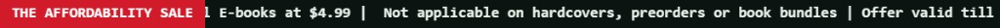
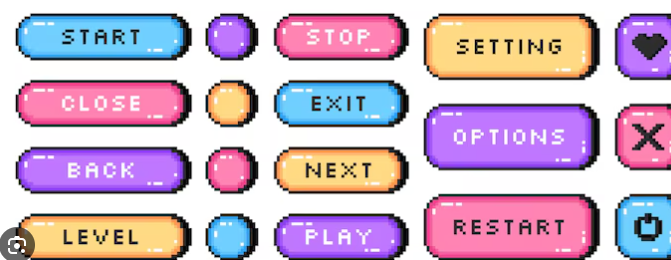

# Holiday sale — OR Books AFFO/RDABILITY (site embellishments)

## Client email (source of truth — original ask)

**From:** Antara Ghosh  
**To:** Rus  
**When:** 2026-11-12, ~1:44 PM  
**Subject:** (as received — holiday sale embellishments)

> Hi Russ,
>
> This is something we'd like to know if you'd be able to do for our Holiday Sale, which we will run from Monday till December 20. This will, of course, be separate from the rest of the website work (I'll get back to you on the Wave 2 stuff tomorrow). Basically, we want to add some embellishments to the website temporarily. Here is what we are thinking:
>
> 1. A 'Sticker' like this would appear on all pages. This is just a placeholder to give you the idea. I'll be sending you the designed sticker. Would be great if it could be blinking/flashing in some way to draw the eye. Maybe next to the OR logo?
> 2. I've attached a video of a ticker. We'd like to have something like this going at the top of all pages. Again, this is just a reference to show you what we are thinking.
>
> The idea (Colin's!) is to make it intentionally tacky, garish, and very in-your-face in terms of the discounts. We are calling it the OR Books AFFO/RDABILITY Sale.
>
> If this is something you'd be interested in doing for us, please let me know. I'll send more details and mockups to help you get a better idea, and you can give us an estimate based on that. What do you think?
>
> Best,  
> Antara

Full thread (including Nov 13 replies) is in **Email thread** at the bottom.

---

## Meta

| Field | Value |
|-------|--------|
| **Briefboard id** | Phase **Holiday Banner** (sprint/phase 6) — https://lancemonotone.com/or-books/app/estimates?section=holiday-banner (or Estimates → Holiday Banner). Cards 6.1–6.4 = **5h / $625** |
| **Client contact** | Antara Ghosh |
| **Sale window (client)** | Through **December 20** (extension possible; keep take-down easy to push out) |
| **Working title** | OR Books **AFFO/RDABILITY** Sale |
| **Tone** | Intentionally tacky, garish, in-your-face (Colin) |
| **Status** | Jumping ahead of client estimate approval. **6.1 ticker done locally** (no BB client comment yet). Next: 6.2 sticker. |
| **Branch** | `feature/holiday-banner` (off staging; theme = `orbooks-theme/`) |
| **Theme tree** | Preview on **`orbooks-theme/`** (staging store first). After approval, port to **`orbooks-theme-prod-download/`** (sync from live) → prod push. |
| **Deploy** | Staging preview → client OK → prod. Temporary / toggleable. Extra staging→prod port time **eaten** (not in 5h quote). |

## Client ask (current)

**Core (estimate):**

1. **Sticker** — site chrome (mockup: by logo under ticker). Slow continuous pulse. Working art: `Affordability Sale Pop-Art Burst.png`; (almost) final: `Sticker.png` (**transparent bg**; may still tweak after Colin). Phone size: figure out in build.
2. **Top ticker** — sticky preferred (skip if too costly). Pixel / old video-game style font (**we pick the face**). Colors from her Amara ticker ref. Full copy locked (below). Not on cart/checkout/account. **Visual only — no links.**

**Layout (from Nov 13 mockup):** Header (logo + sticker) first; **ticker between header and content**; carousel stays theirs for sale promo graphics. (Email said “above the usual stuff”; mockup wins for ticker placement.)

**Optional / last priority (call in estimate or skip):**

3. **In Focus sale badge / dangling label** — Antara: “hanging/oscillating near the In Focus section,” marked on `sale homepage.jpg` (mockup shows a red “ROCK BOTTOM PRICE” burst on the first In Focus cover). For deeper-discount titles during the sale. Last priority; skip if too much. **Also visual only — no links.**

**Idea only (do not estimate now):**

4. Enable thin banners between New Releases / Bestsellers / In Focus with tacky graphics (theme option already exists, currently disabled).

## Rus decisions (Nov 13)

| Topic | Call |
|-------|------|
| Links / click targets | **None.** Sticker, ticker, In Focus badge = visual only. |
| Pixel font | **We choose** closest webfont to her `image.png` vibe. |
| Phone sticker size | Decide in build. |
| Theme | **Staging first** (`orbooks-theme/` → staging store), then port to prod (`orbooks-theme-prod-download/`, sync from live) after approval. Dual-deploy extra ~1h **eaten** (not billed). |

## Decisions from Antara (Q1–7)

| # | Topic | Answer |
|---|--------|--------|
| 1 | Sticker | Working: `Affordability Sale Pop-Art Burst.png`. Almost final: `Sticker.png` (OR slash, **transparent PNG**). May change after Colin. Phone size: we’ll decide in build. |
| 2 | Ticker video + copy | Built on [Amara News Ticker Generator](https://amarasoftware.com/news-ticker-generator/) (see below). Assets: `ticker-mwejkcuk.gif` + still. Colors red/yellow. Font vibe: `image.png`. **Wording locked.** |
| 3 | Animation | Constant, not extremely fast; slow continuous pulse. Open to Rus suggestions. |
| 4 | Above vs replace | **Above** usual stuff (mockup). |
| 5 | Sticky | Prefers sticky; OK to skip if complex/time-consuming. |
| 6 | Take-down | Manual **or** auto: whichever is least work for Rus. Extension should be easy. |
| 7 | Page exclusions | Ticker not needed on cart/checkout/account; all other pages. Leaves judgement to Rus. |

### Locked ticker copy

```
THE OR BOOKS AFFO/RDABILITY SALE: All paperbacks at $14.99 | All E-books $4.99 | Not applicable on hardcovers / pre-orders / pre-discounted book bundles | Free shipping above $100 | Weekly gifts for lucky customers | Offer valid till December 20 | Hurry!!
```

## Reply status

- Rus Nov 12 reply **sent**.
- Antara Nov 13 ~2:40 AM + ~10:51 AM: answers + assets (see thread below).
- BB wave **Holiday Banner** created Nov 13 (phase 6; after Wave 2 Deferred). Cards 6.1–6.4 = 5h.
- Estimate reply **DRAFT** in email thread below. Not sent until Rus approves.
- **No Briefboard delivery comments yet** — client has not approved the estimate; local jump-start only.

## Build progress (internal)

### 6.1 Sticky top sale ticker — done locally

| Field | Value |
|-------|--------|
| **taskKey** | `d53216a9-8660-4c4d-8423-ed0729c0cdcf` |
| **BB comment** | **None yet** (wait for client estimate go-ahead) |
| **Commits** | `c7cfc04` Add sticky AFFO/RDABILITY sale ticker under the header (6.1) |

**Delivered (local):**

- Sticky CSS marquee between header and content (mockup placement).
- Locked sale copy; red/yellow; Silkscreen; pause on hover; reduced-motion calm.
- Hidden on cart / checkout / account / auth.
- Theme setting `or_holiday_banner` (Holiday Banner in Theme Editor) gates the chrome.
- No bottom border under ticker.

**Verify:** `stencil start` → homepage → ticker under header; scroll sticks; cart page has no ticker.

## Assets on hand / still needed

| Item | File |
|------|------|
| Sticker placeholder (Nov 12) | `sticker-placeholder-sale.png` |
| Ticker still (Nov 12, superseded) | `ticker-reference-still.png` |
| Homepage mockup (Nov 13) | `sale homepage.jpg` |
| Sticker working (Nov 13 AM) | `Affordability Sale Pop-Art Burst.png` |
| Ticker video + still (Nov 13) | `ticker-mwejkcuk.gif`, `ticker-mwejkcuk-still.png` |
| Pixel font / UI ref (Nov 13) | `image.png` |
| Sticker almost final (Nov 13 later) | `Sticker.png` (transparent) |
| Click / link targets | **None** (Rus) — visual only |
| Thin inter-section banners art | Idea only; not for estimate |

## Amara ticker generator (what it is)

URL she used: https://amarasoftware.com/news-ticker-generator/

**Not a library** to install or depend on. Browser tool that:

- Lets you configure headlines, colors, speed, presets
- Exports **HTML + embedded CSS animation** (paste/adapt), or **GIF / MP4 / WebM**

Her GIF/still = look + color + motion reference (and/or an export from that tool). We should **rebuild in our theme** (Handlebars + SCSS/CSS, maybe tiny JS), matching colors/behavior — not load Amara as a third-party widget. Optional: peek at their exported HTML pattern (duplicate track + CSS transform marquee + reduced-motion) and reinvent cleanly in `orbooks-theme-prod-download/`.

## Technical read (theme)

- **Codebase:** Implement on `orbooks-theme/` for staging preview; after approval, port to `orbooks-theme-prod-download/` (sync from live first) and push prod. Keep sale chrome isolated (partials + toggle) so the port stays small.
- Custom strip above header for sticky ticker + sticker (not stock BC banner alone).
- Exclude cart/checkout/account for ticker (and sticker as appropriate).
- No hrefs on sale chrome.
- Take-down: prefer **theme setting / simple toggle** (least work + easy sale extension).
- Optional: In Focus dangling/oscillating badge (see above); last priority.
- Thin banners between rails: out of estimate per Antara.
- Reduced motion: calmer pulse / static ticker when `prefers-reduced-motion`.
- Sticker: `Sticker.png` transparent; we pick pixel webfont.

**Not in embellishment estimate:** catalog prices, coupons, free-shipping rules, carousel promo art (they manage), sale landing page content.

## Scope boundaries (for estimate)

**In:**

- Sticky (or non-sticky) top ticker sitewide except cart/checkout/account
- Header-area sticker with slow pulse
- Prod theme push; easy on/off / extension
- Optional line item: In Focus oscillating label (or explicitly skipped)

**Out of this estimate:**

- Thin banners between sections (idea only)
- Redesigning sticker art
- Sale pricing / BC promotions / coupons / free shipping config
- Wave 2 cards
- Carousel sale graphics (their end)

## Estimate posture (internal)

**Client estimate (Rus, Nov 13): 5 hours** @ $125/hr = **$625**.

Covers: sticky top ticker; header sticker + slow pulse; In Focus hang/oscillate badge; sale on/off toggle; mobile/polish buffer. Visual only. Thin banners **out**.

**Workflow (internal):** build on staging theme first for review → after approval, port to prod theme + push live. Staging→prod port (~1h) **eaten**, not added to the quote.

| Slice | Hours |
|-------|-------|
| Sticky ticker | 1.5 |
| Header sticker + pulse | 1.25 |
| In Focus hang/oscillate badge | 1.0 |
| Toggle + smoke / polish buffer | 1.25 |
| **Client total** | **5.0** |
| Staging→prod port (eaten) | ~1.0 |

Rate: $125/hr.

## Related / follow-up

- BB **Holiday Banner** phase live: 6.1 ticker 1.5h, 6.2 sticker 1.25h, 6.3 In Focus badge 1h, 6.4 toggle/prod 1.25h (total 5h).
- Wave 2 still pending her separate reply.

## Screenshots / media

Embedded under each message in **Email thread**. Index:

| File | Message | Role |
|------|---------|------|
| `sticker-placeholder-sale.png` | Nov 12 AM | Placeholder sticker |
| `ticker-reference-still.png` | Nov 12 AM | Early ticker still (red/black; superseded) |
| `sale homepage.jpg` | Nov 13 ~2:40 AM | Layout mockup (ticker + sticker + In Focus mark) |
| `Affordability Sale Pop-Art Burst.png` | Nov 13 ~2:40 AM | Sticker in mind (may change) |
| `ticker-mwejkcuk.gif` | Nov 13 ~2:40 AM | Ticker motion / color ref |
| `ticker-mwejkcuk-still.png` | Nov 13 ~2:40 AM | Still from that ticker |
| `image.png` | Nov 13 ~2:40 AM | Pixel / old video-game font vibe |
| `Sticker.png` | Nov 13 ~10:51 AM | (Almost) final sticker — transparent bg |

---

## Email thread (running log)

Chronological. Mark **DRAFT** until sent; after send, drop DRAFT and keep the body as sent. Attachments shown under the message that sent them.

### Antara Ghosh — Thu, Nov 12, ~1:44 PM

To: Rus

Hi Russ,

This is something we'd like to know if you'd be able to do for our Holiday Sale, which we will run from Monday till December 20. This will, of course, be separate from the rest of the website work (I'll get back to you on the Wave 2 stuff tomorrow). Basically, we want to add some embellishments to the website temporarily. Here is what we are thinking:

1. A 'Sticker' like this would appear on all pages. This is just a placeholder to give you the idea. I'll be sending you the designed sticker. Would be great if it could be blinking/flashing in some way to draw the eye. Maybe next to the OR logo?


2. I've attached a video of a ticker. We'd like to have something like this going at the top of all pages. Again, this is just a reference to show you what we are thinking.



*(Note: she said video here; this PNG still is what we had from that first mail. Motion file arrived Nov 13.)*

The idea (Colin's!) is to make it intentionally tacky, garish, and very in-your-face in terms of the discounts. We are calling it the OR Books AFFO/RDABILITY Sale.

If this is something you'd be interested in doing for us, please let me know. I'll send more details and mockups to help you get a better idea, and you can give us an estimate based on that. What do you think?

Best,  
Antara

### Rus Miller — Thu, Nov 12 (sent)

To: Antara Ghosh  
Subject: Re: *(same thread)*  
Attachments: none

Hi Antara,

Yes, I'd be glad to do this for the Holiday Sale. Intentionlly tacky sounds fun. We'll create a new wave in BB for these tasks, separate from our current work.

Once you've got the designed sticker and any other mockups or details, send them over and I'll put together an estimate for both the sticker and the top-of-page ticker.

A few things that'll help me scope it:

Final sticker file. When you have it, please send the designed asset. Any preferred size on desktop, and is it okay if we scale it down on phones so it doesn't crowd the logo?

Ticker reference. Your note mentioned a video, but I only received the still of the red/black "THE AFFORDABILITY SALE" bar. Was there a separate video file, or is the still the main reference? Also, the still cuts off at "Offer valid till…" What's the full final ticker copy (and end date wording)?

Sticker animation. How aggressive should the blink/flash be: continuous flashing, a gentler pulse, or something that only draws attention now and then? Some visitors prefer reduced motion (browsers can signal that), and we can respect that in CSS so those people get a calmer version. I'd like your guidance on how strong you want the default animation for everyone else.

Top of page vs existing banners. Should the sale ticker sit above any current top-of-site banners, or replace them for the sale window?

Sticky or not. Should the ticker stay pinned at the top while people scroll, or scroll away with the page?

Take-down. Prefer it to turn off automatically after December 20 (e.g. end of day Eastern), or a manual take-down push from me when you're ready?

Any pages to skip? All pages including cart/checkout/account, or exclude any of those?

No rush on answering these before the mockups if it's easier in one package. Looking forward to the final sticker and whatever else you've got in mind.

Thanks,
Rus

### Antara Ghosh — Fri, Nov 13, ~2:40 AM

To: Rus  
Attachments: `sale homepage.jpg`, `Affordability Sale Pop-Art Burst.png`, `ticker-mwejkcuk.gif`, `ticker-mwejkcuk-still.png`, `image.png`

Hi Rus,

So glad you are on board with this! We've always wanted to try things out but haven't been able to, as we did not have the coding expertise! BigCommerce definitely does not make it easy. Colin is especially excited about this!

I was thinking we do the ticker and sticker above the usual stuff. Something like the mockup I've attached. The carousel will have sale-related promo graphics that we keep changing from our end. The take-down can be manual or automatic: whichever requires the least work from your end. In case there is an extension of the sale, would it be easy to do? I'll leave this to your judgement.


Sticker:  
I'm attaching the sticker I have in mind. This might change based on Colin's input. I'll be able to confirm it today. I'm thinking the animation could be constant, but not extremely fast. Just a slow, continuous pulse of sorts. But I'm open to your suggestions.


Top Ticker:  
I'm also attaching the ticker video I forgot to attach yesterday. This is a reference that I created on this website [https://amarasoftware.com/news-ticker-generator/ — URL confirmed separately; not in original body]. You don't have to use this necessarily but it gives you the colours we'd like to use. The font we'd like is something like those used in pixel art/ old video games. Reference below:




The wording should be: THE OR BOOKS AFFO/RDABILITY SALE: All paperbacks at $14.99 | All E-books $4.99 | Not applicable on hardcovers / pre-orders / pre-discounted book bundles | Free shipping above $100 | Weekly gifts for lucky customers | Offer valid till December 20 | Hurry!!

I think making it sticky would be good. But if that's too complex or time-consuming, we can skip it.

Regarding page exclusions: I think the ticker is not needed on the cart/checkout/account. It can remain on all others. But I'll leave this to your judgement.

Another label/animation for the 'In Focus' section:  
I've marked it in the mockup. Can we do something like this hanging/oscillating near the 'In Focus' section? We plan to have a landing page with even deeper discounted titles which we'd like to feature here during the sale. This is the last priority, so if this to too much, we can skip it.

Additional possibilities: You may have already seen them on the homepage theme files, but we have the option of having these thin banners between the New Releases, Bestsellers, and In Focus that we have kept disabled at this time. We could enable them and add more tacky/garish graphics there. Just putting the idea out. You don't need to include this in your estimate at this time.

Thanks!!  
Antara

### Antara Ghosh — Fri, Nov 13, ~10:51 AM

To: Rus  
Attachments: `Sticker.png`

Hi Rus,

The (almost) final sticker is attached. Let me know if you need it in any particular format or size.


Antara

### Rus Miller — DRAFT (not sent)

To: Antara Ghosh  
Cc: Colin Robinson *(optional)*  
Subject: Re: *(same thread)*

Hi Antara,

Thanks for the mockup, the ticker reference, and the sticker. The transparent PNG is perfect; no other format needed from my side. If Colin has a final tweak, just send the new file and I'll use that.

I've put the estimate on a new Briefboard wave called **Holiday Banner**, separate from Wave 2:

https://lancemonotone.com/or-books/app/estimates?section=holiday-banner

**Total: 5 hours, $625** at $125/hr.

What's included:

- Sticky top ticker with your locked sale wording, red/yellow colors from your reference, and a pixel-style font. Hidden on cart, checkout, and account.
- Header AFFORDABILITY SALE sticker by the logo, with a slow continuous pulse.
- The In Focus "ROCK BOTTOM PRICE" hanging/oscillating badge from your mockup.
- An easy on/off for all of this, so take-down after December 20 (or an extension) is simple.

These are visual only (no click-through links). The thin banners between New Releases / Bestsellers / In Focus stay out of this estimate, as you said. Carousel sale graphics stay on your end.

Same checkpoint as usual: if a task is nearing its estimate and more work is needed, I'll pause and check with you before continuing.

If this looks good, I'll build it on the staging store first so you can review it there. Once you're happy with it, I'll push the same treatment to the live site.

Thanks,
Rus
